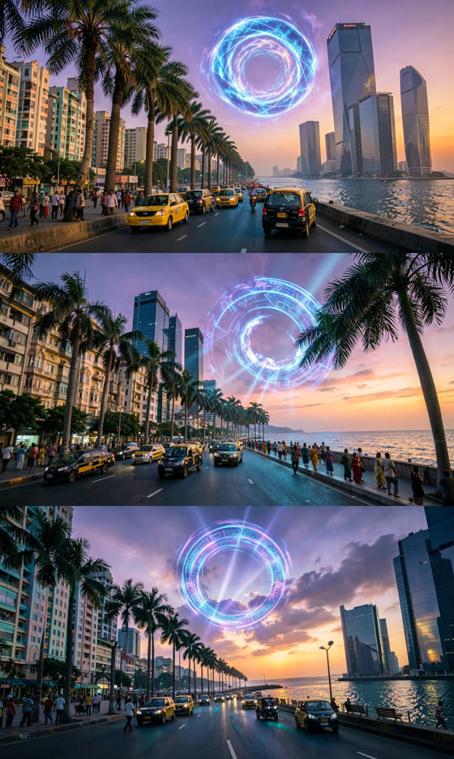
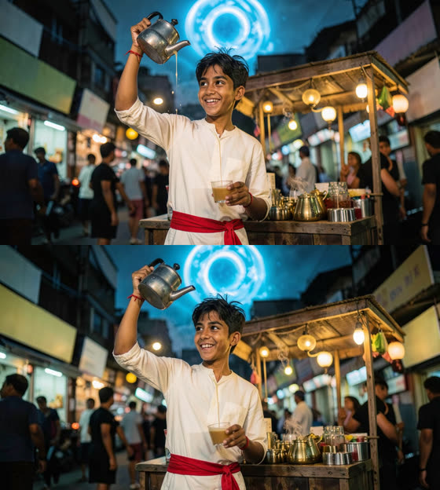
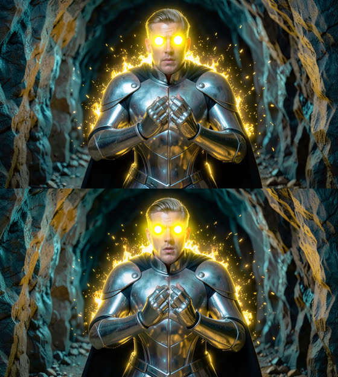
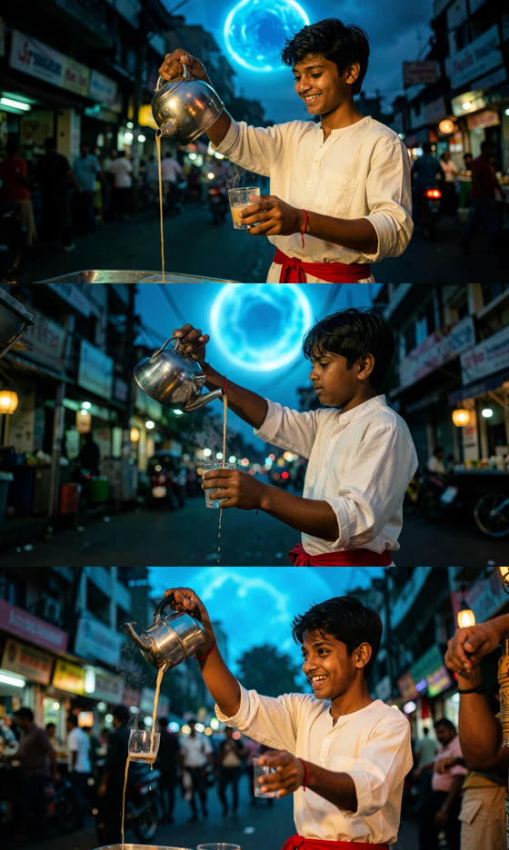
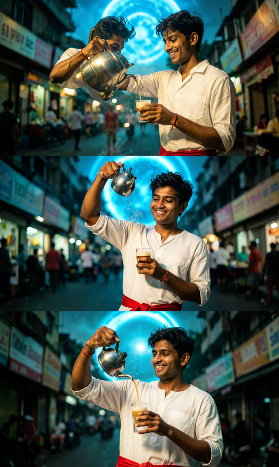
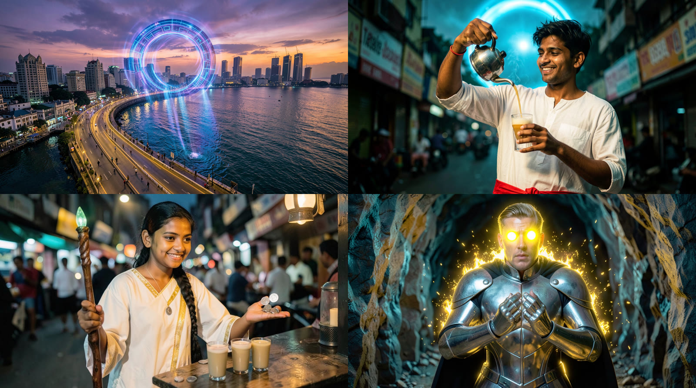

# Production log: Episode 1, movie version

Every attempt is written down here: **what we gave** (the prompt; the full text is in the spec file named), **what
came out** (the picture), **the mistakes**, and **how we solved them**. Newest round at the bottom.
Pictures in `log/` are small copies; the full-size ones stay in `out/` (not in git).

Tools used so far:
- Pictures: FLUX.2 [klein] 4B on Cloudflare Workers AI (free, about 60 pictures a day). Run with
  `python3 videos/doodle/imagegen.py SPEC.json OUT_DIR`.
- Motion: Wan 2.1 image-to-video on our free Hugging Face Space (Rggroups/anime-motion). Run with
  `python3 videos/manga/animate.py SHOTS.json IMG_DIR OUT_DIR`.

Used so far (18 Nov): 42 pictures (plus 1 refused by the safety filter) of the free daily Cloudflare allowance of
about 60, and 83 s of the free daily GPU time. Money spent on pictures: ₹0.

---

## 18 Nov, round 1: the first style test (look A vs look B)

**What we gave:** 4 test shots: S05 Mumbai and the Gate, S08 Arjun's tea pour, S17 Meera paying, S26 Viktor's
power-up. Each shot was made twice with the same prompt and seed: look A "bright superhero blockbuster" and look B
"dark gritty action film". Specs: `styletest_A.json`, `styletest_B.json`.

**What came out:**

Motion test (look A, 2 s each, free Space, `styletest_motion.json`): the tea pours and Viktor's aura flares up.

**Mistakes found (look A, checked at full size):**
| Shot | Mistakes |
|---|---|
| S08 Arjun | looks about 28 with a moustache, not 18; the tea stream misses the glass and falls to a bowl at the back; a shirt with a pocket, not a kurta |
| S17 Meera | holds a short walking stick, not a healer's staff; touches a glass instead of putting down coins; two glasses look like black coffee, not chai; neon signs with nonsense letters |
| S26 Viktor | looks about 45; armored arms but bare hands; the cape floats with no clasps; the aura is a thin outline like a sticker |
| S05 Mumbai | fake letters all around the portal ring; does not look like Mumbai (no sea, no taxis, no palms) |
| Look B | Arjun pours low into a jug; Meera's picture has a misspelled "ChaiWallaH" sign |

**How we solve it:** rewrite every prompt with exact details: Arjun "18, clean-shaven, no moustache, long collarless
kurta, kettle in the right hand above a glass in the left hand, one stream into the glass"; Meera "tall carved staff
with a green crystal, three silver coins, milky light-brown chai"; Viktor "28, young face, steel gauntlets, cape with
round silver clasps, aura rising like flames"; Mumbai "Marine Drive, Arabian Sea, palm trees, black-and-yellow taxis,
plain geometric patterns, no letters". Add "correct anatomy, five fingers" to the look. Make 3 versions of each.

---

## Round 2: rewritten prompts, 3 versions each (`styletest_A2.json`)

   

**Better:** Arjun is now young and wears a kurta (version 2); Meera has a real staff with a green crystal and milky
chai (version 3); Viktor has gauntlets, clasps and a flame-like aura; Mumbai has palms, the sea and real
black-and-yellow taxis (version 2). One Viktor picture was refused by the safety filter; another seed passed.

**Mistakes still there:**
- Arjun: no tea comes out of the kettle at all (v2); v3 holds two kettles fused together; v1 still has stubble.
- Meera: v1 has two braids (should be one); v2 has a second stick; v3 touches a glass instead of placing coins.
- Viktor: v1 and v2 look about 35-40 and v1's armor has a strange chest shape; v3 is the right age but his eyes
  are blue, not glowing.
- Mumbai: the cars drive on the right side of the road (India drives on the left); fake writing on taxi doors.

**How we solve it:** keep the best version of each and send it back to the model with ONE exact correction
("the same photo, but ...") instead of drawing it again. This needed a small new feature in `imagegen.py`
(an `"edit"` picture per image).

---

## Round 3: one correction per picture (`styletest_A3_fixes.json`, 2 tries each)

   

**Solved:** Viktor's eyes now glow golden (try 1 is kept).

**Not solved:**
- Arjun: try 1 has a stream, but it falls behind his head, not into the glass; try 2 has no stream.
- Meera: she still touches a glass, or seems to drop a coin into the chai.
- Mumbai: the cars still come toward the camera on the left, which is right-hand driving.

**How we solve it:** change the shot itself, not just the words: Arjun seen from the side with the kettle directly
above the glass; Meera holding the coins out on her open palm (much easier to draw correctly than "placing" them);
Mumbai from high above (the famous curved Queen's Necklace view), where no driving side can be seen.

---

## Round 4: new framing (`styletest_A4.json`)

  

**Solved:**
- Meera: try 1 holds three coins on her open palm; staff, single braid and three glasses of chai are all right.
- Mumbai: version 3 shows the curved seafront, the sea and the Gate with a plain pattern and no letters.
  (Version 1 looks like a bridge, not Mumbai; version 2 has letter-like marks on the ring.)

**Not solved:** Arjun. v2 finally pours into the glass, but he looks about 15 and the stream keeps dripping below the
glass; v1 pours past the glass; v3 has a glass floating in the air.

**How we solve it:** first try another correction of v2 ("make him 18, the stream ends inside the glass").

---

## Round 5: correction of Arjun v2 (`styletest_A5.json`)

**Worse:** he now looks about 12, the smile is gone, and the kurta turned into a collared shirt.

**Lesson:** a correction only works for small changes. The model sees a very small copy of the picture (under
512 pixels), so details like age get lost. Age must come from the main prompt.

**How we solve it:** draw again from the start and say "a young man of 18, college-student age" instead of
"18-year-old boy" (the word "boy" makes the model draw a child).

---

## Round 6: Arjun drawn again (`styletest_A6.json`)

**Solved, version 3:** a young man of about 18-20 with a clean-shaven face; the kettle is held high, the stream goes
from the spout into the glass and stops there; white kurta, red sash, red string bracelet; five fingers on each hand.
(Version 1 has a second man behind him holding the kettle; version 2's stream is too faint.)

**Still to fix:** the shop signs in the background still have unreadable fake letters, even though the prompt says
"no writing". The model cannot keep signs blank.

**How we will solve it (next):** when we make the real keyframes, every street shot gets a stronger background blur
behind the people (we cut out the people with a person mask and blur only the background), so no sign can be
read. If that is not enough, the shots are framed tighter so fewer signs are visible.

---

## Result after round 6: the 4 test shots

| Shot | Kept picture | Checked |
|---|---|---|
| S05 Mumbai | round 4, v3 | curved seafront, sea, palms, Gate without letters |
| S08 Arjun | round 6, v3 | age, kurta, sash, bracelet, stream into the glass, hands |
| S17 Meera | round 4, try 1 | staff, one braid, coins on her palm, three milky chai glasses, hands |
| S26 Viktor | round 3, try 1 | age, gauntlets, clasps, flame aura, glowing eyes |

Full-size copies: `out/keyframes_ok/`.

**Known issues left for the next step:** the background signs (see round 6); each character's face is different in
every new picture, which the face sheets (next step, day 2) fix by giving every shot the same face reference.
