# Production log: Episode 1, movie version

Every attempt is written down here: **what we gave** (the prompt; the full text is in the spec file named), **what
came out** (the picture), **the mistakes**, and **how we solved them**. Newest round at the bottom.
Pictures in `log/` are small copies; the full-size ones stay in `out/` (not in git).

Tools used so far:
- Pictures: FLUX.2 [klein] 4B on Cloudflare Workers AI (free, about 60 pictures a day). Run with
  `python3 videos/doodle/imagegen.py SPEC.json OUT_DIR`.
- Motion: Wan 2.1 image-to-video on our free Hugging Face Space (Rggroups/anime-motion). Run with
  `python3 videos/manga/animate.py SHOTS.json IMG_DIR OUT_DIR`.

Used so far (18 Nov): 42 pictures (plus 1 refused by the safety filter) of the free daily Cloudflare allowance of
about 60, and 83 s of the free daily GPU time. Money spent on pictures: ₹0.

---

## 18 Nov, round 1: the first style test (look A vs look B)

**What we gave:** 4 test shots: S05 Mumbai and the Gate, S08 Arjun's tea pour, S17 Meera paying, S26 Viktor's
power-up. Each shot was made twice with the same prompt and seed: look A "bright superhero blockbuster" and look B
"dark gritty action film". Specs: `styletest_A.json`, `styletest_B.json`.

**What came out:**

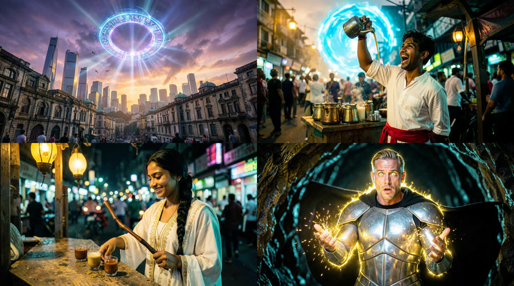
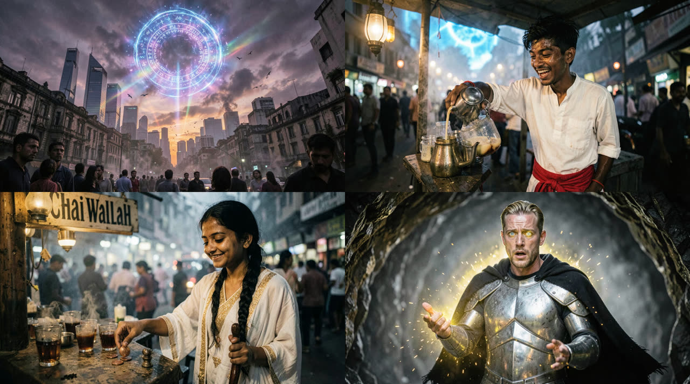

Motion test (look A, 2 s each, free Space, `styletest_motion.json`): the tea pours and Viktor's aura flares up.

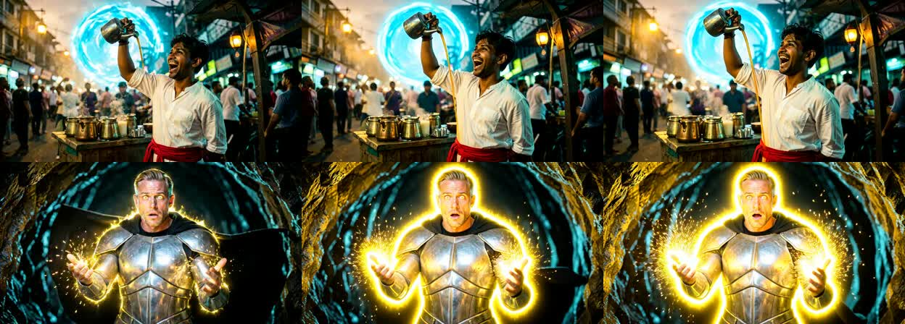

**Mistakes found (look A, checked at full size):**
| Shot | Mistakes |
|---|---|
| S08 Arjun | looks about 28 with a moustache, not 18; the tea stream misses the glass and falls to a bowl at the back; a shirt with a pocket, not a kurta |
| S17 Meera | holds a short walking stick, not a healer's staff; touches a glass instead of putting down coins; two glasses look like black coffee, not chai; neon signs with nonsense letters |
| S26 Viktor | looks about 45; armored arms but bare hands; the cape floats with no clasps; the aura is a thin outline like a sticker |
| S05 Mumbai | fake letters all around the portal ring; does not look like Mumbai (no sea, no taxis, no palms) |
| Look B | Arjun pours low into a jug; Meera's picture has a misspelled "ChaiWallaH" sign |

**How we solve it:** rewrite every prompt with exact details: Arjun "18, clean-shaven, no moustache, long collarless
kurta, kettle in the right hand above a glass in the left hand, one stream into the glass"; Meera "tall carved staff
with a green crystal, three silver coins, milky light-brown chai"; Viktor "28, young face, steel gauntlets, cape with
round silver clasps, aura rising like flames"; Mumbai "Marine Drive, Arabian Sea, palm trees, black-and-yellow taxis,
plain geometric patterns, no letters". Add "correct anatomy, five fingers" to the look. Make 3 versions of each.

---

## Round 2: rewritten prompts, 3 versions each (`styletest_A2.json`)

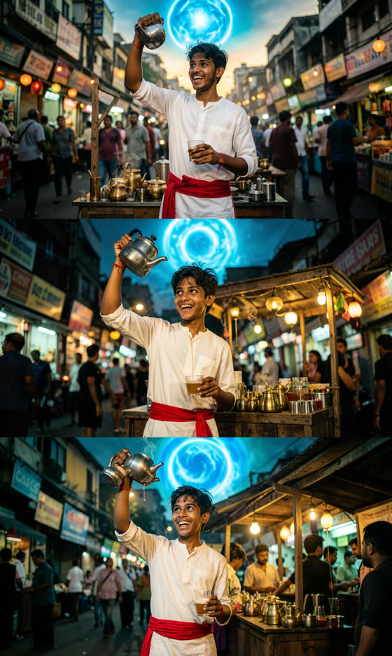 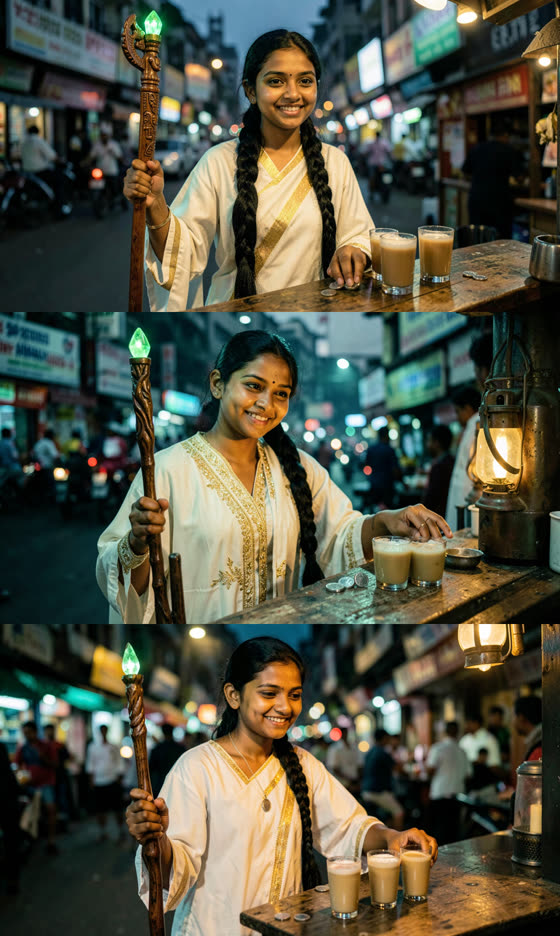 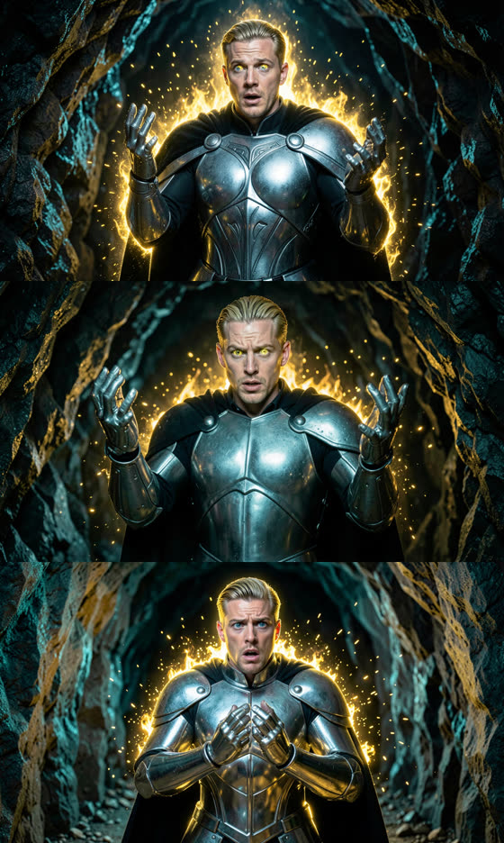 

**Better:** Arjun is now young and wears a kurta (version 2); Meera has a real staff with a green crystal and milky
chai (version 3); Viktor has gauntlets, clasps and a flame-like aura; Mumbai has palms, the sea and real
black-and-yellow taxis (version 2). One Viktor picture was refused by the safety filter; another seed passed.

**Mistakes still there:**
- Arjun: no tea comes out of the kettle at all (v2); v3 holds two kettles fused together; v1 still has stubble.
- Meera: v1 has two braids (should be one); v2 has a second stick; v3 touches a glass instead of placing coins.
- Viktor: v1 and v2 look about 35-40 and v1's armor has a strange chest shape; v3 is the right age but his eyes
  are blue, not glowing.
- Mumbai: the cars drive on the right side of the road (India drives on the left); fake writing on taxi doors.

**How we solve it:** keep the best version of each and send it back to the model with ONE exact correction
("the same photo, but ...") instead of drawing it again. This needed a small new feature in `imagegen.py`
(an `"edit"` picture per image).

---

## Round 3: one correction per picture (`styletest_A3_fixes.json`, 2 tries each)

 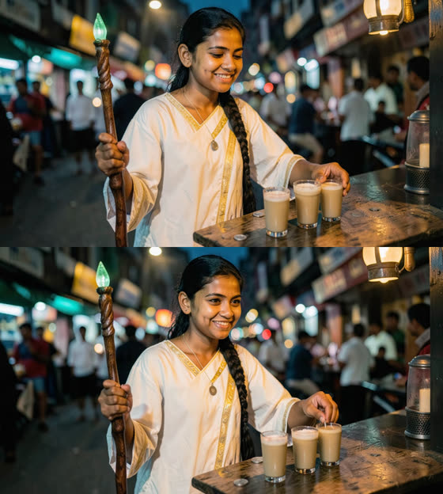  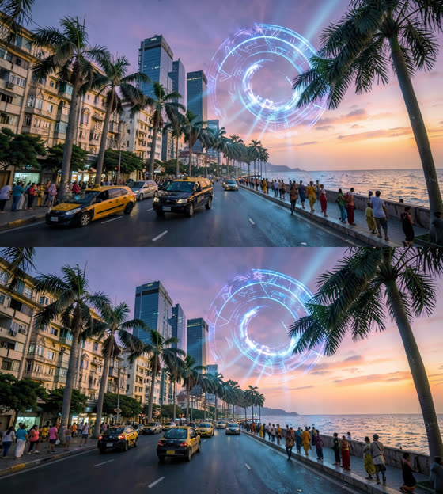

**Solved:** Viktor's eyes now glow golden (try 1 is kept).

**Not solved:**
- Arjun: try 1 has a stream, but it falls behind his head, not into the glass; try 2 has no stream.
- Meera: she still touches a glass, or seems to drop a coin into the chai.
- Mumbai: the cars still come toward the camera on the left, which is right-hand driving.

**How we solve it:** change the shot itself, not just the words: Arjun seen from the side with the kettle directly
above the glass; Meera holding the coins out on her open palm (much easier to draw correctly than "placing" them);
Mumbai from high above (the famous curved Queen's Necklace view), where no driving side can be seen.

---

## Round 4: new framing (`styletest_A4.json`)

 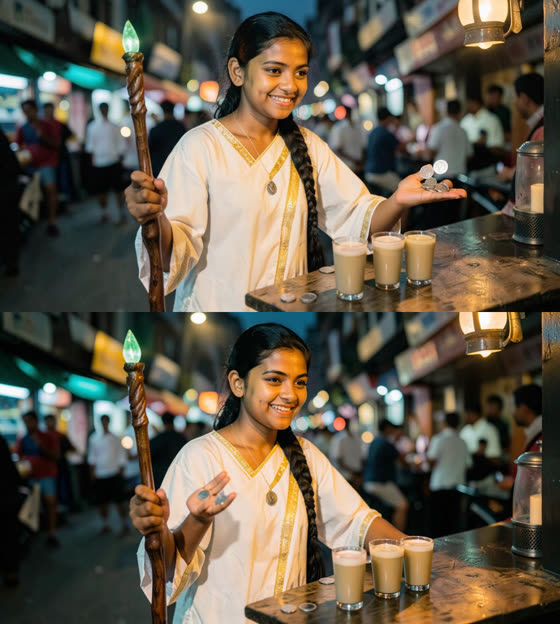 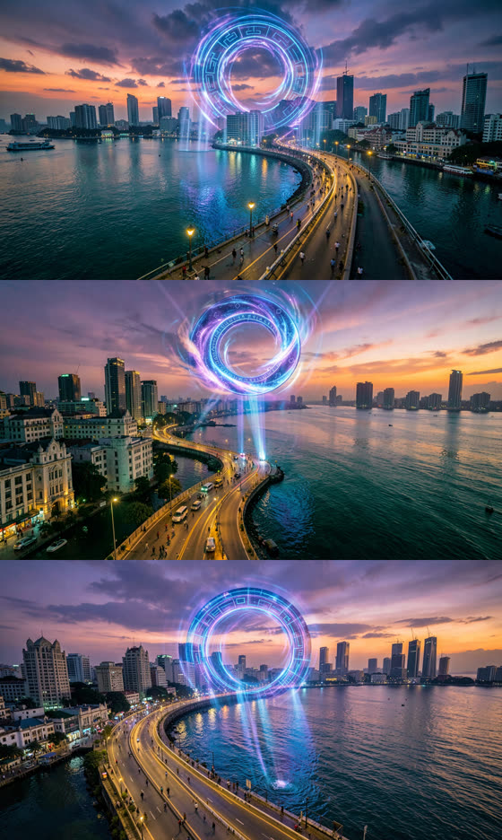

**Solved:**
- Meera: try 1 holds three coins on her open palm; staff, single braid and three glasses of chai are all right.
- Mumbai: version 3 shows the curved seafront, the sea and the Gate with a plain pattern and no letters.
  (Version 1 looks like a bridge, not Mumbai; version 2 has letter-like marks on the ring.)

**Not solved:** Arjun. v2 finally pours into the glass, but he looks about 15 and the stream keeps dripping below the
glass; v1 pours past the glass; v3 has a glass floating in the air.

**How we solve it:** first try another correction of v2 ("make him 18, the stream ends inside the glass").

---

## Round 5: correction of Arjun v2 (`styletest_A5.json`)

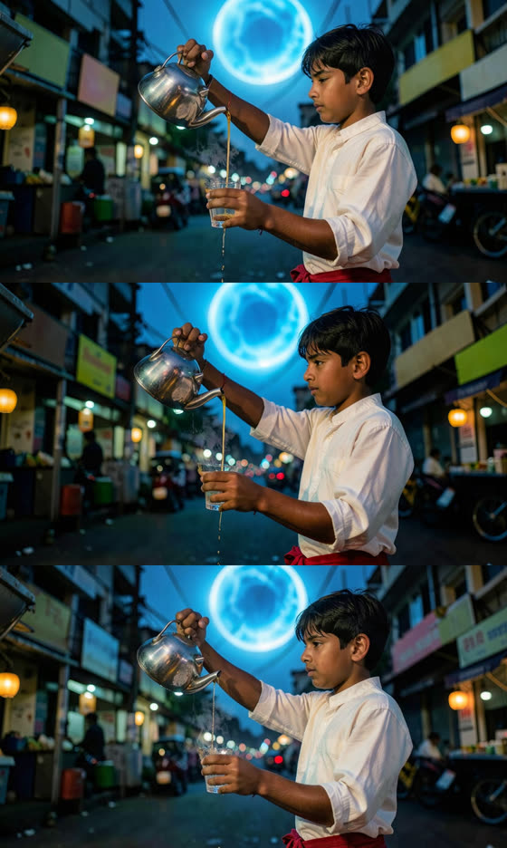

**Worse:** he now looks about 12, the smile is gone, and the kurta turned into a collared shirt.

**Lesson:** a correction only works for small changes. The model sees a very small copy of the picture (under
512 pixels), so details like age get lost. Age must come from the main prompt.

**How we solve it:** draw again from the start and say "a young man of 18, college-student age" instead of
"18-year-old boy" (the word "boy" makes the model draw a child).

---

## Round 6: Arjun drawn again (`styletest_A6.json`)

**Solved, version 3:** a young man of about 18-20 with a clean-shaven face; the kettle is held high, the stream goes
from the spout into the glass and stops there; white kurta, red sash, red string bracelet; five fingers on each hand.
(Version 1 has a second man behind him holding the kettle; version 2's stream is too faint.)

**Still to fix:** the shop signs in the background still have unreadable fake letters, even though the prompt says
"no writing". The model cannot keep signs blank.

**How we will solve it (next):** when we make the real keyframes, every street shot gets a stronger background blur
behind the people (we cut out the people with a person mask and blur only the background), so no sign can be
read. If that is not enough, the shots are framed tighter so fewer signs are visible.

---

## Result after round 6: the 4 test shots

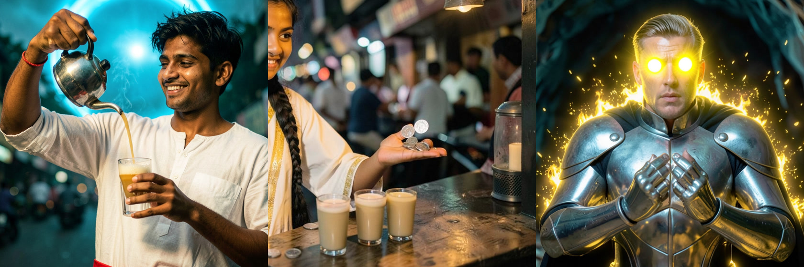

| Shot | Kept picture | Checked |
|---|---|---|
| S05 Mumbai | round 4, v3 | curved seafront, sea, palms, Gate without letters |
| S08 Arjun | round 6, v3 | age, kurta, sash, bracelet, stream into the glass, hands |
| S17 Meera | round 4, try 1 | staff, one braid, coins on her palm, three milky chai glasses, hands |
| S26 Viktor | round 3, try 1 | age, gauntlets, clasps, flame aura, glowing eyes |

Full-size copies: `out/keyframes_ok/`.

**Known issues left for the next step:** the background signs (see round 6); each character's face is different in
every new picture, which the face sheets (next step, day 2) fix by giving every shot the same face reference.

---

# Day 2 (18 Nov): face sheets, so every character keeps the same face

Decided by the director (Manoj: "it's up to you"): **look A** (bright blockbuster; dungeon scenes a little darker),
and the tank is called **Raghu**.

## Round 1: a portrait of each character (`faces_r1.json`)

**What we gave:** a casting-sheet portrait (front view, plain grey background, studio light) of each character, made by
correcting their approved test picture (Arjun from S08, Meera from S17, Viktor from S26 "with normal blue eyes, no
aura"); Raghu is new: "huge Indian man, mid-thirties, bald, thick black beard, kind but tough face, heavy dark armor".

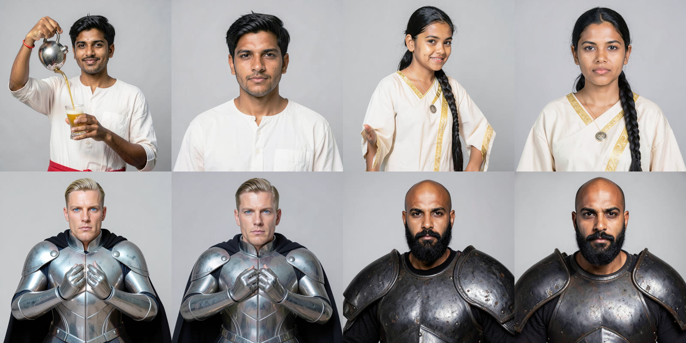

**Mistakes:**
- Arjun: v1 copied the tea-pouring pose instead of a portrait; v2 looks about 25 with stubble and a moustache.
- Meera: v1 looks about 15 and waves a hand; v2 is right (about 22, one braid, robe).
- Viktor and Raghu: both versions are right (Viktor about 28-30 with blue eyes, armor, cape and clasps; Raghu bald
  and bearded in dark armor).

**How we solve it:** Arjun's age got lost again in a correction (the same lesson as day 1, round 5), so his portrait
is drawn from scratch: "a young man of 18 ... completely clean-shaven, no moustache, no beard, no stubble".

## Round 2: Arjun's portrait from scratch (`faces_r2.json`)

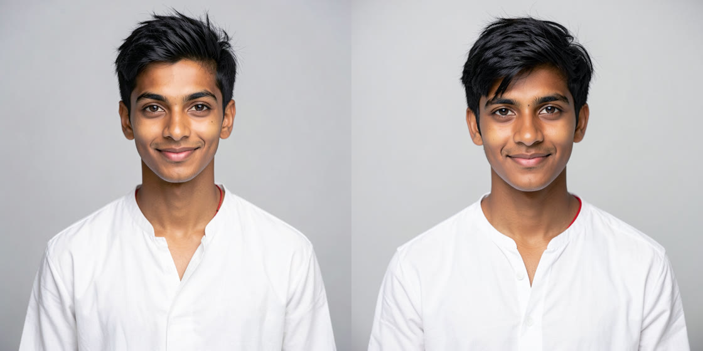

**Result:** both are right: 18, smooth clean-shaven face, messy black hair, white kurta. Version 1 is kept.

## Round 3: the face test, each character in a new scene from their portrait (`faces_test_r1.json`)

**What we gave:** the portrait as image 0 + "the same person, with exactly the same face, in a new scene: ...":
Arjun offering a glass of chai (S15), Viktor laughing and pointing (S14), Meera casting green healing magic in the
cave (S25), Raghu bracing behind his shield as a heavy blow hits it (S23).

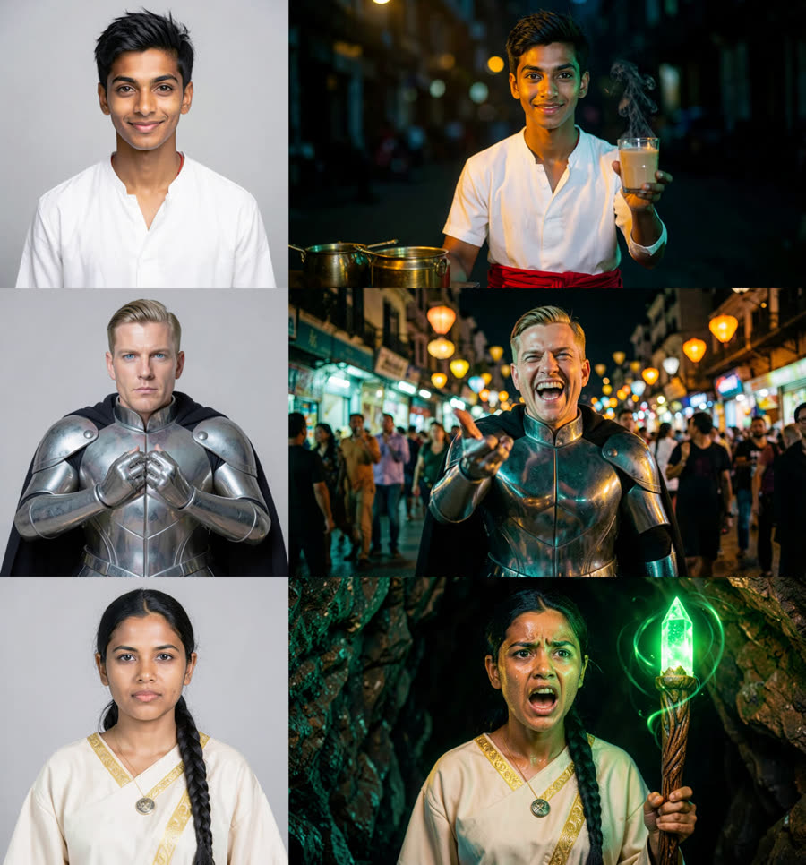

**Result:** the face stays the same for Arjun, Viktor and Meera. The method works.

**Mistakes:**
- Raghu: refused 3 times by Cloudflare's safety filter ("heavy blow", "strained face", sparks and cracks).
- Viktor: he opens his hand instead of pointing a finger; the street behind him has Chinese-style paper lanterns,
  which do not look like Mumbai.
- Arjun: short sleeves instead of rolled-up long sleeves (small).

**How we solve it:**
- Pictures are still frames, so they show calm moments; the violence (the blow, the crack) comes from the motion
  step, where the video model animates it. Raghu's test was re-written as "he stands firm behind his shield".
- Every Mumbai street prompt now names Indian details: "strings of marigold flowers, small oil lamps, Indian shop
  fronts with plain boards", never just "lanterns".
- Gestures that matter (pointing) get 2 tries in the real keyframes.

## Round 4: Raghu again, gentler words (`faces_test_r2.json`)

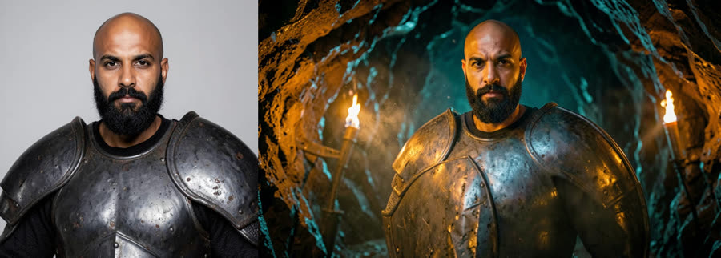

**Result:** the same face, accepted by the filter. **Mistake:** the shield melted into his armor (it looks like a
big chest plate). **How we solve it:** in the real keyframe the shield is described as a separate object: "a tall
rectangular steel tower shield held by a handle on his left arm, standing on the ground in front of him".

## The cast: approved faces (series files in `videos/manga/f-rank/cast/`)

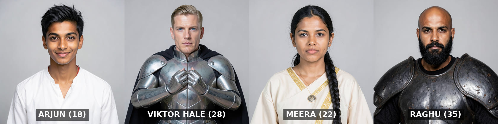

| Character | Face file | From |
|---|---|---|
| Arjun, 18 | `cast/arjun.jpg` | day 2 round 2, v1 |
| Viktor Hale, 28 | `cast/viktor.jpg` | day 2 round 1, v2 |
| Meera, 22 | `cast/meera.jpg` | day 2 round 1, v2 |
| Raghu, 35 | `cast/raghu.jpg` | day 2 round 1, v1 |

Every keyframe with a character from now on is made with that character's face file as image 0. Every face is
invented by the AI; none is meant to look like a real person.

**Used today:** about 59 pictures of the free Cloudflare allowance (the daily limit is reached; it resets at
00:00 UTC, 5:30 am in India). Money spent: ₹0.

**Next (day 3):** the 36 keyframes, made with the face files and the rules learned above, checked one by one and
logged the same way. About 36-70 pictures with retries, so 1-2 days of the free allowance.

---

# Day 3 (18 Nov): the screenplay, and the keyframes on GridShare

## The screenplay
Manoj: "connect the manga panels, give a proper story". `SCRIPT.md` tells Episode 1 as one connected story (13
scenes) with 11 new connecting moments; `shots.json` was rebuilt from it: 56 shots, 48 made by AI.

## Moving the pictures to GridShare (Manoj: "for this use GridShare")
**Why:** a rented RTX 3090 (24 GB, ₹30 an hour) runs the same FLUX.2 [klein] 4B model with no daily limit, and it
can take the face files at full size (Cloudflare only takes a 512-pixel copy).

**How it works (`videos/manga/gridshare/`):** a private drop box on our Cloudflare account (`dropbox.py`, only
our secret key opens it) carries the prompts and face files to the machine and the pictures back; the machine's
start command runs `boot.sh` and `keyframes_worker.py`; `keyframes.py` rents the machine, follows it, saves the
pictures and always ends the machine.

**Mistakes on the way, and the fixes:**
| Try | What went wrong | Cost | Fix |
|---|---|---|---|
| 1 | GridShare gave an Apple M3 Max (cannot run the model) instead of the RTX 3090 | ₹0 (stopped at once) | `node_id` alone is ignored when a size is also sent |
| 2 | gave an RTX 3060 Ti instead | ₹0 | send `preferred_node_id` (what GridShare's app sends) and check the machine we got |
| 3 | crashed after downloading the model: the image's Python is 3.11.0rc1, too old for PyTorch's compiler | ₹9.78 | a 2-minute check run (₹0) found it; the machine now builds its own Python 3.12 with uv |
| 4 | PyTorch was installed into the wrong Python | ₹0.10 | `uv pip install --python /root/venv/bin/python` |
| 5 | **worked**: 96 pictures in 15 minutes (6-19 s each) | ₹21.52 | |

Also decided: the 16 GB model is kept in `/workspace/models` with "keep my large files" on, and the machine is
stopped instead of deleted, so the next machine starts with it (public models are restored before billing starts).

## Round 1 of the keyframes: all 48 AI shots, 2 versions each (`keyframes_job.json`)

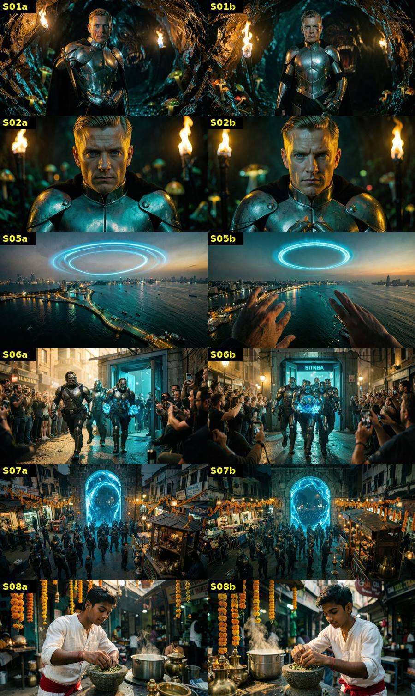 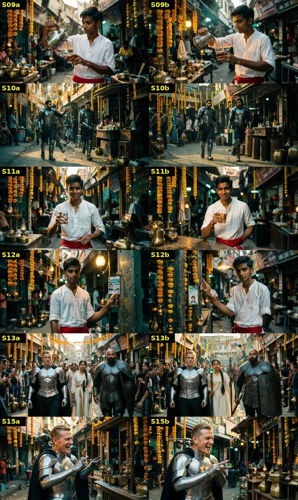 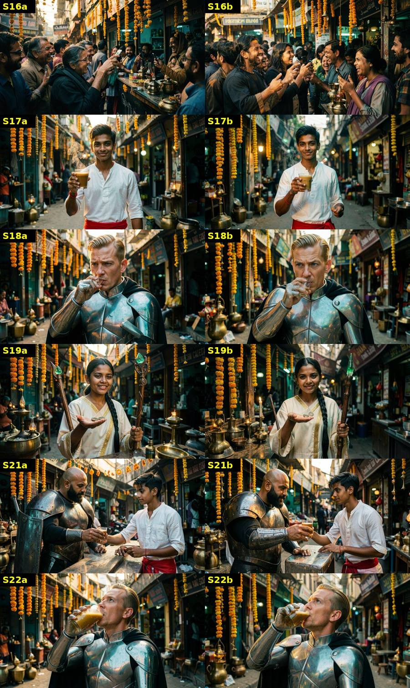 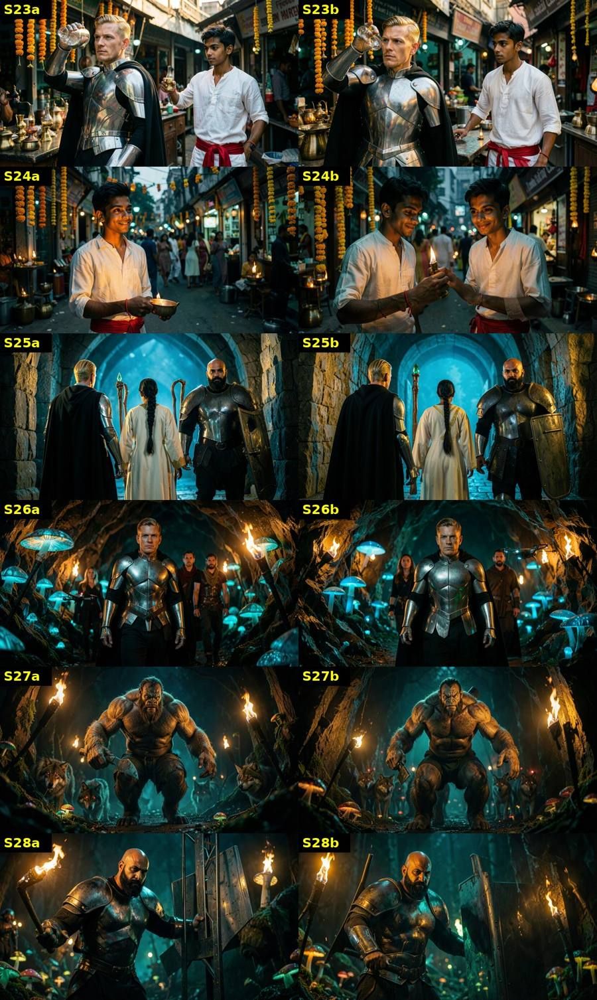
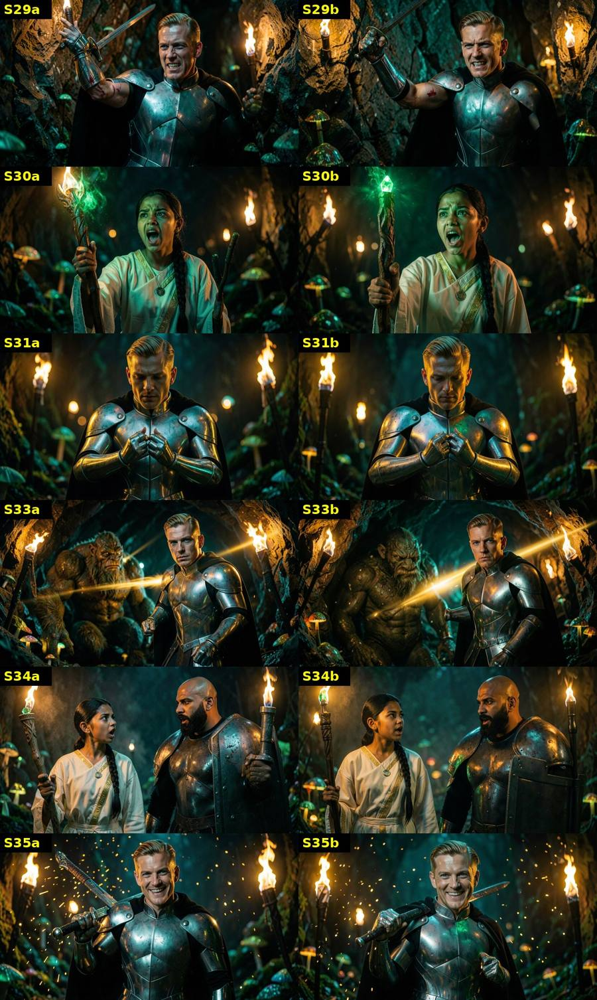 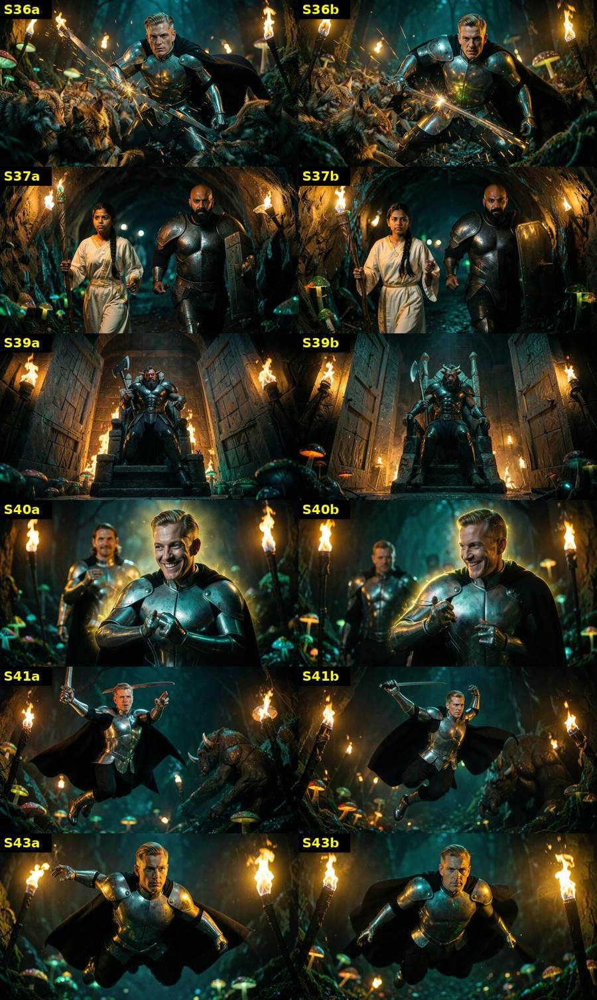 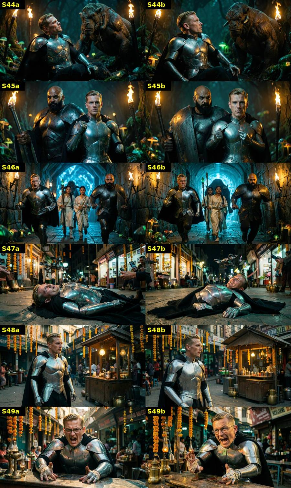 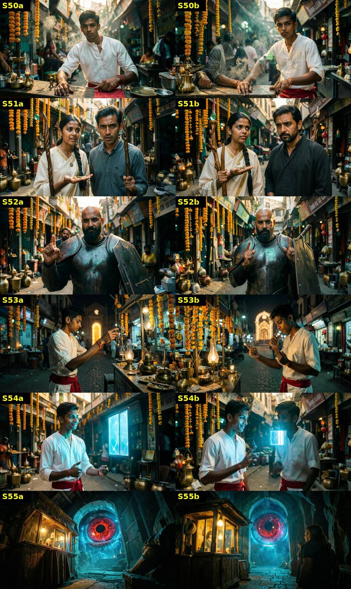

**Result:** the faces stay the same in every shot (Viktor, Arjun, Meera, Raghu). **32 shots are good** (the version
kept is in `keyframes_review_r1.json`, full size in `out/keyframes_ok/`).

**16 shots have mistakes:**
| Shot | Mistake |
|---|---|
| S01 | the monster behind Viktor is fully visible (should stay a dark shape); no golden glow; mushrooms that are not in the scene |
| S02 | eyes stay blue, not glowing gold; not an extreme close-up |
| S06 | the hunters look like grey orcs, not people; a fake word "SITNBA" over the Gate |
| S24 | not a close-up, not dark (a); two Arjuns in one picture (b) |
| S26 | Meera and Raghu missing: two strangers walk behind Viktor |
| S28 | the shield is a strange metal frame, not a shield Raghu braces behind |
| S31 | no golden light on his arms |
| S33 | no slash: Viktor only stands next to the ogre |
| S40 | a random knight behind him instead of the boss far away |
| S45 | Raghu does not grab the cape |
| S46 | two Meeras (a fourth person) |
| S49 | Viktor wears glasses |
| S51 | a random man with a second staff next to Meera |
| S52 | Raghu holds up one finger, not two |
| S53 | the square is busy, not empty; he is not wiping glasses |
| S54 | the blue window is on a wall, not floating (a); two Arjuns (b) |

**Mistakes across many shots:**
1. Several street shots look like **daytime**, but the story happens in the evening (scenes 3-5) and at night
   (10-12). Shots S11, S12, S16, S17, S18, S19, S21, S22 and S50 are too bright.
2. **Glowing mushrooms in every cave shot**: my "darker scene" sentence mentioned mushrooms.
3. **The ogre and the minotaur look different from shot to shot** (they had no reference picture).

**How we solve it (round 2):**
- The 16 shots get rewritten descriptions: say exactly what must be seen ("only his face", "glowing bright golden
  yellow eyes", "his hand grips the cape"), and **how many people are in the frame** ("exactly three people",
  "Meera alone"), because otherwise the model adds strangers or doubles.
- Every street prompt now names the time: "evening after sunset, deep blue sky, all lamps lit" or "late night,
  black sky"; the 9 bright shots are made again.
- The mushrooms are removed from the dungeon sentence (only the entrance cave has them).
- The ogre (from S27 a) and the minotaur (from S39 b) become reference pictures (`cast/ogre.jpg`,
  `cast/minotaur.jpg`), used like the faces.
- Viktor's description now says "no glasses".
- Round 2: 25 shots x 2 versions = 50 pictures on the RTX 3090.

## Round 2: 25 shots again, 2 versions each (16 broken + 9 too bright), on GridShare

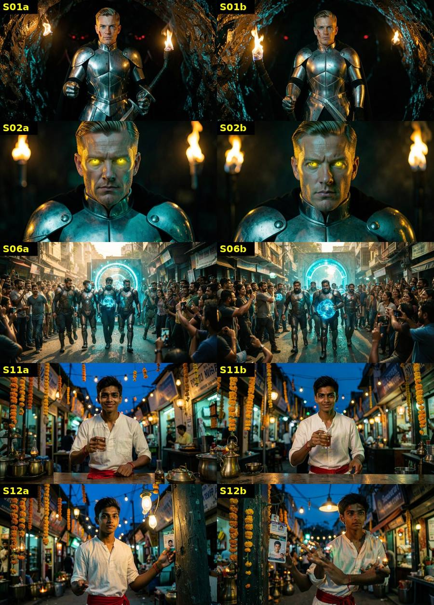 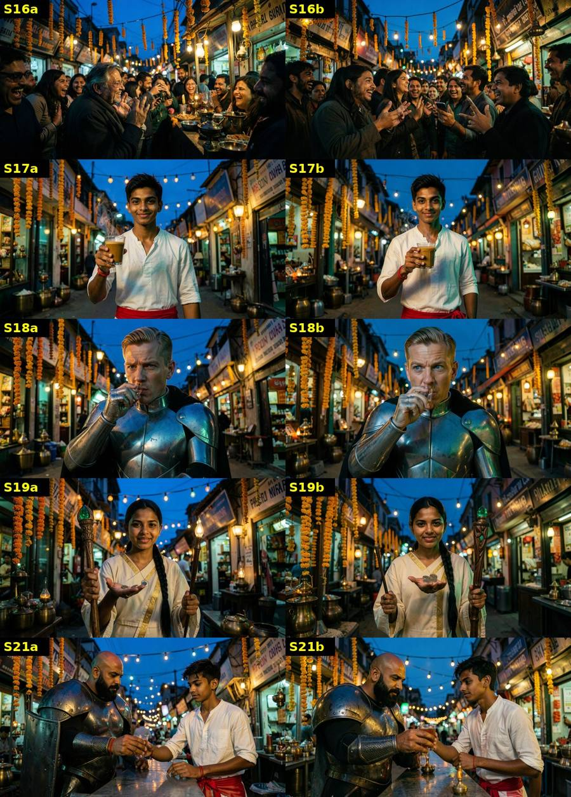 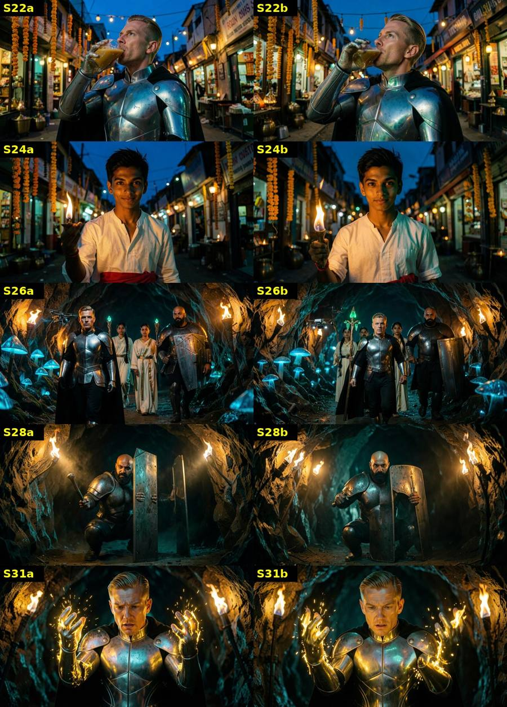
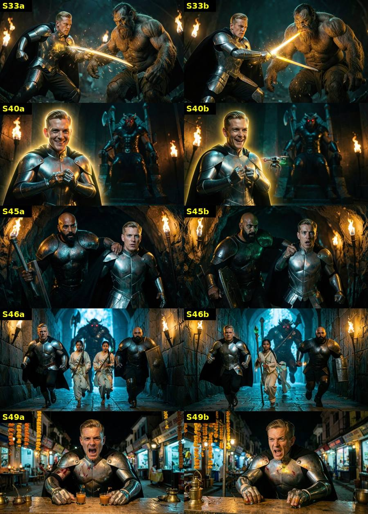 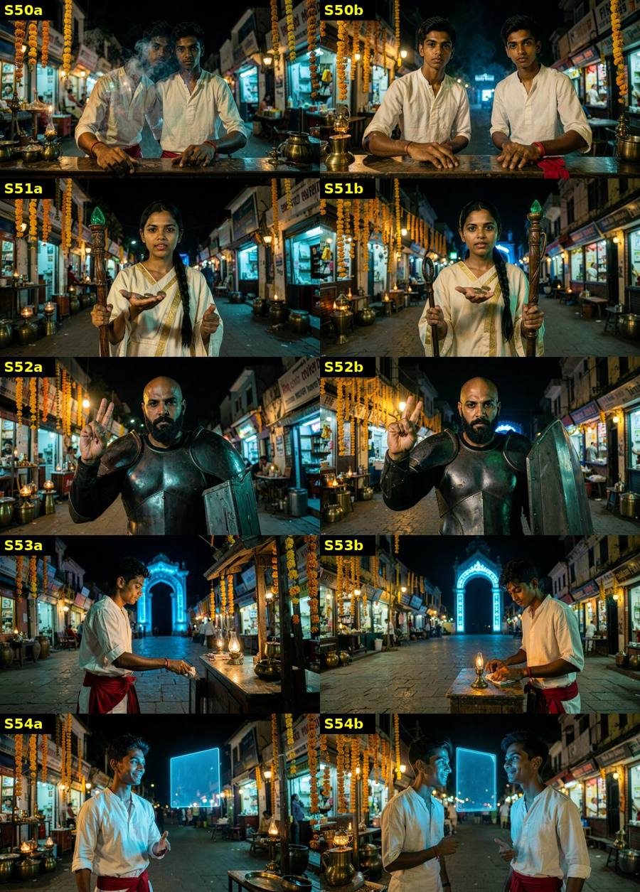

Cost: ₹18.24 (36 minutes: setup, a fresh model download into `/workspace/models`, 50 pictures).

**Solved (22 shots kept, `keyframes_review_r2.json`):** the street shots are now evening (deep blue sky, lamps lit)
and the stall scenes at the end are night; S01 shows only red eyes in the dark; S02's eyes glow gold; the hunters in
S06 are people; S28 Raghu braces behind his shield; S31 golden light on his hands; S33 a real golden slash at the
ogre (the ogre now matches its reference); S40 the minotaur on its throne far behind (and the drone); S45 Raghu's hand
on Viktor's shoulder and cape; S46 exactly three runners and the minotaur; S49 no glasses; S51 Meera alone with one
staff; S52 two fingers; S53 the empty square, wiping a glass; S54 a floating blue panel. S24 is still a medium shot,
not a tight close-up: it will be cropped tighter in the edit.

**Still wrong (3 shots):**
| Shot | Mistake | Cause | Fix |
|---|---|---|---|
| S19 | Meera holds two staffs | her description says "carrying a staff" and the shot says "staff in her other hand" | the shot now says "only ONE staff, in her left hand ... exactly one staff in the picture" |
| S26 | Meera appears twice (and an extra man in b) | three people from three face pictures; the model repeats one | "exactly two companions, one woman and one huge bald man ... each person appears only once" |
| S50 | two Arjuns | the shot text said "steam drifting between them", which asks for two people | "Arjun alone ... steam in front of him ... only one person" |

**Lesson:** read every shot description for words that imply more people ("them", "they", "between") and remove them.

**Model saving:** GridShare's status after the stop: the 3 big model files are listed as "not saved" (public model
files are not stored; GridShare says they are re-downloaded free on restore) and the backup was still uploading when
the machine stopped. Round 3 starts from this machine's files (`restore_from_instance_id`) to see whether the model
comes back without a paid download.

## Round 3: the last 3 shots, 3 versions each, starting from the saved machine (`--restore`)

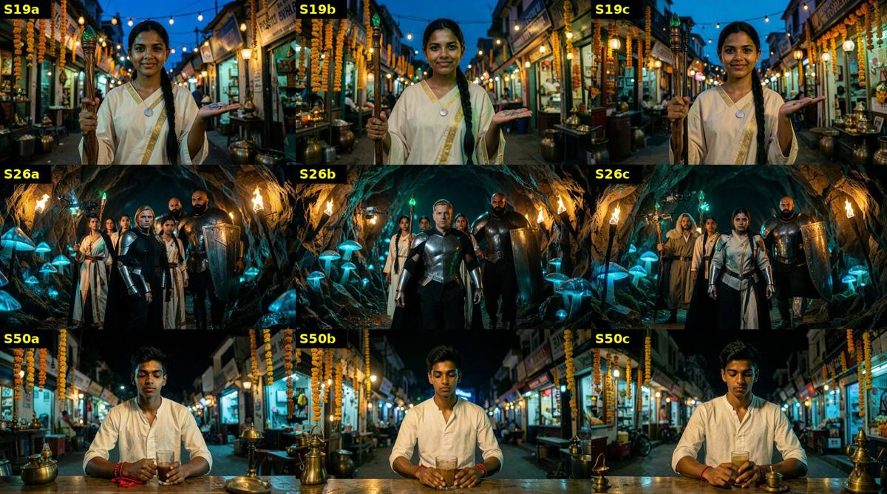

Cost: ₹14.14. **The model was NOT restored**: GridShare does not store public model files (it lists them as "not
saved") and did not bring them back, so it was downloaded again (15 minutes). Keeping it as our own file would cost
about ₹96 a month plus a one-time upload (about ₹38): only worth it with 12+ sessions a month, so we download each
session and do the work in big batches instead.

**Solved:** S19 (b): one staff, coins on her palm, evening. S50 (b): Arjun alone, deadpan, night.

**Still wrong:** S26: all three versions add extra people (4 to 7) when three face pictures are given in one shot.
**Director's decision:** S26 becomes "Viktor alone with his camera drone, talking to chat"; Meera and Raghu are heard
behind him and seen in the next shots. It is made in the next GridShare session with the video clips.

## The storyboard after day 3

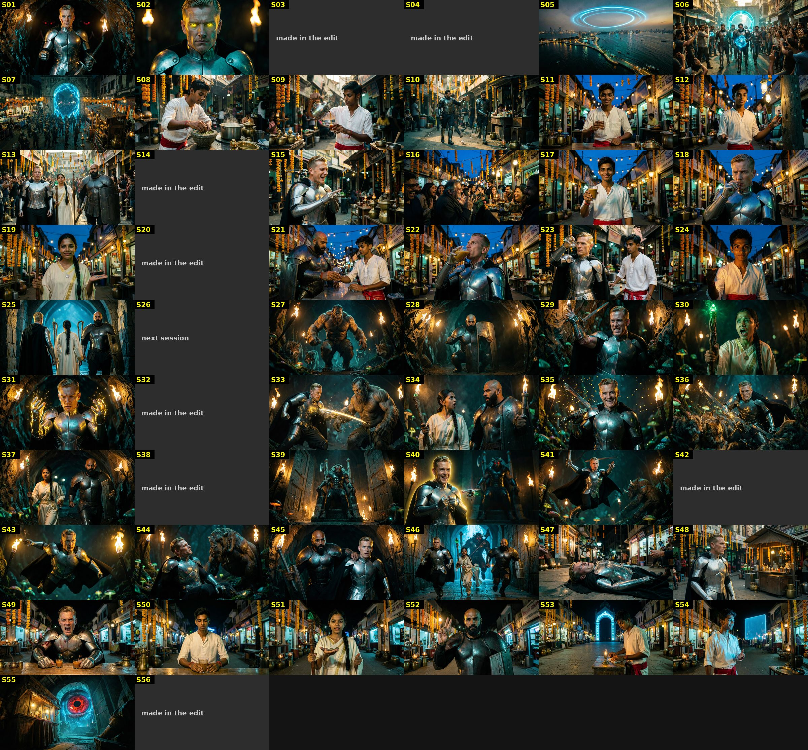

47 of 48 AI keyframes approved (full size in `out/keyframes_ok/`); the 8 grey "made in the edit" cards (title, clock,
name cards) are made in the edit; S26 comes next session.

**GridShare spending on 18 Nov:** ₹64.41 in total (balance ₹494.93 → ₹430.52). Keyframes runs: ₹21.52 + ₹18.24 + ₹14.14;
the rest was the tests and the failed first try.

---

# Day 3, continued: the voices (before ElevenLabs ends on 2 Dec)

**Casting (director's pick; `videos/manga/voices.py`, model Eleven v4):**
| Character | Voice | Backup tested |
|---|---|---|
| Narrator | Manoj kumar T (the owner's clone) | - |
| Arjun | Bunty - Warm and Clear (young, Indian, relaxed) | Manav - Friendly, Calm and Natural |
| Meera | Tara - Conversational and Expressive (young, Indian, an actress) | Anika - Sweet and Lively |
| Viktor | Liam - Energetic, Social Media Creator (young, American) | - |
| Raghu | Viraj - Deep, Resonant and Lyrical (Indian) | - |

The casting test (`out/casting.m4a`, sent to Manoj) was checked with Whisper: every line heard right, and the acting
tags ("[laughs]", "[shouting]") were performed, not spoken.

**All 39 lines** (`voice/SNN.wav`, not in git; 2 min 16 s in total) were made with an acting direction per line
(`"tag"` in `shots.json`, e.g. S15 "[laughs]", S50 "[deadpan]", "(quietly)" becomes a whisper).

**Mistake on the way:** the first acting directions were put on the wrong shot numbers (the narrator got "[smugly]",
"Boss time." got "[shouting]"). Fixed by printing every line with its direction and correcting them before recording.

**Listening check (Whisper, small model):** 26 lines exact. The 13 flagged were checked one by one: numbers written as
digits (10, 18, 58, 60), "tea" written as "T", "Meera" as "Mira", and battle cries that are not words ("Tch",
"HYAAAH") are all fine. One to listen to: S14 "Zero manners" is heard as "manors" in all 3 takes; it is the Indian
"maa" sound of the narrator's clone, not a wrong word. A bigger listening model could not be downloaded (the disk is
almost full), so this one is for Manoj's ear.

## The voices, adjusted (Manoj: "save the voice model for continuous run, and a little adjustment")

**Saved for every episode:** the cast's voices are now a series file, `videos/manga/f-rank/cast/voices.json` (voice,
voice id, model, stability, similarity, tempo per character); `voices.py` reads it for any episode of the series.

**Adjustment (Manoj picked "slower, clearer pace" and "more emotion / acting"):**
- Pace: 8% slower. ElevenLabs' own "speed" setting did nothing on the Eleven v4 model (the length stayed 118 s), so
  the pace is set after recording with ffmpeg's atempo, which keeps the voice's pitch: 118 s -> 128 s. Saved as
  `"tempo": 0.92` per character.
- Emotion: lower stability (more expressive): narrator 0.25, Arjun 0.35, Meera 0.3, Viktor 0.2, Raghu 0.3; stronger
  acting directions: Viktor "[arrogantly]", "[laughs arrogantly]", "[furious, shouting]"; Meera "[panicked,
  shouting]", "[shocked, breathless]"; Arjun "[mysteriously, whispering]", "[deadpan]"; narrator "[dramatically]" at
  the start, "[ominously, slowly]" at the end, "[dramatic pause]" for "Minute sixty."
- Listening check after the change: no direction was spoken aloud; only the known homophones ("tea" written "T",
  "manners" heard "manors") and the battle cries are flagged.

The first take is kept in `out/voice_v1/` for comparison. New preview: `out/dialogue_preview_v2.m4a` (2 min 27 s).

---

# Day 3, continued: the first animation test on GridShare (failed)

**What we gave:** 2 shots (S09 tea pour, S31 golden power-up), Wan 2.2 TI2V-5B image-to-video (Apache-2.0), each at
1280x704 (5 s, 121 frames, 30 steps) and at 832x480 (`videos/manga/gridshare/clips.py`, `clips_worker.py`).

**What happened:**
| Try | Machine | Result | Cost |
|---|---|---|---|
| 1 | RTX 3090 | refused: rented by someone else ("fully rented") | ₹0 |
| 2 | 2x RTX 4000 Ada | refused: "on this Windows machine the GPUs are rented together" (double price) | ₹0 |
| 3 | RTX 4090, ₹48/hour | the 31 GB model took 31 minutes to download; the first 5-second clip at 1280x704 was still not done after 25 minutes at 100% GPU; then the home PC's container crashed ("exited unexpectedly") at 58 minutes | ₹46.76 |

No clip came back. **What we learned:**
1. Wan 2.2 TI2V-5B at full 720p is too slow for us: more than 25 minutes per 5-second clip on an RTX 4090, so 48
   clips would be about 20 hours (about ₹950).
2. Each GridShare session pays 30 minutes just to download the 31 GB video model.
3. Home-PC machines can crash in the middle of a job; the money for the time it ran is not refunded.
4. The runner now shows GridShare's refusal reason, and the "no progress" limit can be set per run (`--stall`).

**GridShare total for 18 Nov:** ₹111.17 (balance ₹494.93 -> about ₹383.76).

## The animation plan after the failed test (Manoj chose "Mix + GridShare")

- **20 shots get AI motion** (`"anim": "ai"` in `shots.json`): S01, S02, S08, S09, S15, S17, S18, S19, S22, S23, S28,
  S30, S31, S33, S36, S41, S43, S45, S46, S49: the shimmer, the pour, the toss and catch, the power-up, the slash, the
  leap and the fizzle, the shield impact, the cape yank, the sprint, the counter slam and the main talking moments.
  Wan 2.2 TI2V-5B at 832x480 (about 4x faster than 1280x704), 20 steps, on the RTX 3090 (it ran 3 sessions without
  a crash; the 4090 home PC crashed), upscaled to 1920x1080 in the edit.
- **27 shots get camera moves made here, free** (`"anim": "camera"`; `videos/manga/camera.py`): each move follows the
  shot's direction (S07 floats down to the stall, S39 tilts up to the minotaur, S53 pulls back from the lonely stall,
  S55 rises to the Gate, S27 a small shake for the roar, S24 cropped tighter for Arjun's close-up); smooth start and
  stop; 1920x1080, 24 fps; made in about 2 minutes for all 27. S26 still needs its picture.
- Disk on this cloud machine was down to 0.8 GB: the 1.2 GB of "silent" in-between renders of already uploaded videos
  were deleted (the finished videos are kept; the in-between files can be rebuilt).

## AI clips, try 1 on the RTX 3090 (failed: out of memory)

The 31 GB video model took 46 minutes to download; the first clip then rendered well (about 5 seconds a step, so
about 2 minutes for a 20-step clip at 832x480), but the program was killed in the middle of the clip without an error
message: the home PC has only 21.5 GB of RAM, and the "offload" setting kept the 11 GB text model and the 10 GB video
model in RAM. Cost: ₹27.69, no clip.

**Fix:** `clips_worker.py` now encodes all 20 prompts first, frees the text model completely, then keeps the video
model and the VAE on the graphics card (RAM use less than half); it also writes a progress note at steps 1, 10 and
20 of each clip, so a stall shows at once. Try 2 started straight away on the same RTX 3090.

## AI clips, try 2 (stopped by Manoj's choice: Google Flow)

Try 2 ran on the same RTX 3090 with the memory fix, but Manoj chose Google Flow (Veo 3.1) for the AI shots, so it was
stopped. Lesson: stopping the watcher's shell did not stop its Python program, and the machine kept billing; it was
stopped by hand with `POST /instances/{id}/stop` (₹21.73). From now on: stop the Python program itself and check that
the machine shows "stopped". **GridShare total for 18 Nov: ₹160.59** (balance ₹494.93 -> ₹334.34). Nothing runs there.

## Google Flow pack, then automation (Manoj: "use google flow", then "lets find way to automate it")

- **What we gave:** `flow_shots.json` / `FLOW_SHOTS.txt`: the 20 AI shots, each with its start picture, a prompt (the
  shot's motion + one fixed live-action style line), the length (4 or 6 s) and 2 takes for the 5 hardest shots (S23,
  S33, S43, S45, S46): 25 clips. Drive folder "F-Rank Ep1 - Google Flow" with the 20 start pictures in "keyframes".
- **Automating Flow:** the Flow website has no official API; unofficial tools that drive it break Google's rules and
  need the Google login, so we did not use them. Veo 3.1 itself is sold through the Gemini API (`veo_clips.py`, about
  $6 with Lite or $12 with Fast for all 25 clips, money limit built in), but it has no free use and needs a key with
  billing. Manoj asked for free sources instead.
- **Free sources checked:** Hugging Face ZeroGPU (works now on his free account, a few minutes a day), Modal ($30 free
  a month: all clips in about an hour), Kaggle (about 30 GPU hours a week, older GPUs), Alibaba Cloud Model Studio
  (some free seconds per Wan model for new users). Not free: Veo/Gemini API (Google's $300 trial does not cover it),
  Kling/Hailuo/Runway (free credits only on their websites, not for commercial use).

## Free AI clips, round 1: Wan 2.2 on Hugging Face ZeroGPU (`videos/manga/zerogpu_clips.py`)

- **What we gave:** each start picture + its Flow prompt to the public Space `zerogpu-aoti/wan2-2-fp8da-aoti-faster`
  (Wan 2.2 14B, Apache-2.0, run by Hugging Face's own ZeroGPU team), 6 steps, at most 5 s (the Space's limit), seed 7.
  It comes back at 832x480, 16 fps; the script keeps that raw clip and makes a 24 fps copy (smooth in-between frames)
  stretched to the shot length, at `out/clips/SNN_a.mp4`, where the edit looks first.
- **How it came out** (`log/clips_free_round1.jpg`), 4 clips, 49-92 s each, free:
  - **S09, the pour: good.** Real-looking, the tea stream falls into the glass, steam, he turns and smiles; the face
    stays the same.
  - **S02, the eyes: good.** The eyes light up yellow, the light flares to white, as written.
  - **S08, the cardamom: good motion, one thing missing.** He crushes the pods with his hands in the stone bowl and
    tips them in; steam rises; the faint golden shimmer did not appear (it can be added in the edit as a light effect).
  - **S01, the cave: one mistake.** The torches flicker and his face stays the same, but "golden light on his armor"
    turned the silver chest plate copper-brown, and it stays that way. **Fix:** remake it at the end with "a soft
    golden glow shines on his silver armor, the armor stays silver".
- **Mistakes in the run:** a free account has only a few minutes of GPU a day (each 5 s clip asks for about 105 s),
  so the run stopped after 3 new clips. S15 was made but the download was refused (403) and S17-S22 failed with no
  reason given (the time was used up and the Space hides the message), so the run kept queuing for nothing.
  **Fix:** the script now stops after two failures in a row. The next free run is booked for when the time resets.

## The first cut, checked (`out/episode_cut1.mp4`, 3:47)

- **How it came out:** the whole story plays with the voices, sound effects, music and cards; loudness -14.8 LUFS
  (YouTube's level); the 20 AI shots are still pictures with slow camera moves, as planned until the clips exist.
- **Mistakes:**
  - **S26 is a black screen for 4 seconds** (1:55, "Level 9. Easy content, chat."): the shot never got its picture.
  - **S02 (the cold open close-up): Viktor looks about 15 years older** than in every other shot. The approved picture
    has the older face; its free clip was made from it. To fix: a new S02 picture from his face file, then a new clip.
  - The 1.5 s of black before "TO BE CONTINUED" is kept on purpose (a beat after the eye).

## S26, round 4: Viktor alone with his drone, free on Cloudflare (`log/s26_round4.jpg`)

- **What we gave:** the S26 prompt from the shot list ("Viktor alone ... talking with a grin to a small camera drone")
  with his face file as image 0; 3 versions.
- **How it came out:** all three have his face, the glowing mushrooms, the drone and torches, but they copied the pose
  of the face picture (hands clasped at the chest) and none grins; version a also has two strangers behind him.
- **Correction 1 (edit of version b, "he grins and waves at the drone"):** the grin and wave worked, but his face
  aged to about 40, the same age drift we saw on day 1 with small-copy edits. Not used.
- **Correction 2 (a fresh picture, the grin and the wave written into the prompt, "a smooth-skinned young man of 28",
  "nobody else in the cave"):** version d puts the drone in his hand (wrong); **version e is approved**: alone, young
  cocky grin, waving at the drone floating beside him. Lesson kept: for a new expression or pose, write it into a
  fresh prompt; edits keep the pose but drift the age.

## S02, the face fix (`log/s02_face_fix.jpg`: old left, new right)

- **What we gave, try 1:** a fresh S02 prompt with Viktor's face file as image 0, "a smooth-skinned young 28-year-old".
  **Came out:** the right age, but all 3 copied the face file's pose (hands clasped at the chest) and lost the extreme
  close-up.
- **Try 2:** an edit of the old close-up, "the man is younger, 28, no wrinkles". **Came out:** too young (about 20),
  soft and boyish, no longer Viktor's face.
- **Try 3 (new in `imagegen.py`: `"also"` sends more pictures after image 0):** the old close-up as image 0 for the
  framing, the eyes, torches and armor, plus Viktor's face file as image 1: "only the face changes: exactly the face
  of the man in image 1". **Came out:** version 1 has his face at the right age, with an odd claw-like shape on the
  armor at the bottom; cropped to a tighter close-up (the shot is "eyebrows to chin" anyway), it is approved.
  Version 2 kept the old face.
- The old picture and its clip are kept in `out/retired/`; the S02 clip is made again on the next free run.
- Lesson: to change only a face, give the scene as image 0 and the face file as image 1.

## Cut 2, and the switch to full animation (Manoj: "it's not like a full animation episode, just moving the photo?")

- **Cut 2** (`out/episode_cut2.mp4`, 3:47): S26 in (no more black screen), the 4 free clips in (S01, S02, S08, S09).
- **Mistake (the plan, not a render):** the "Mix" plan gave real motion to only 20 of the 48 picture shots and slow
  camera moves to the other 28, and only 4 clips existed, so the cut still felt like moving photos. Manoj wants
  every shot to move like a real film (he shared an anime Short as an example of full motion, and chose to keep the
  live-action look). **Fix:** `all_shots.json`: all 48 picture shots become AI clips (the 20 Flow shots with their
  prompts and takes, plus the 28 others from their "motion" lines): 53 clips. Still limits: clips are 5 s at most
  (longer shots are stretched a little), and in the 25 talking shots the lips will not match the words yet.
- **GPU for 53 clips:** Modal (free $30 a month) was suggested, then dropped: its client talks gRPC, which this cloud
  session's network does not carry. Manoj subscribed to **Hugging Face PRO** ($9 a month: 40 minutes of ZeroGPU a
  day, about 22 clips), the same Space and script as the free clips, no new keys.

## PRO clips, first try (refused), and what the official docs say

- **What happened:** with PRO active (`isPro: true`), every call failed: the gradio_client library got "cancelled",
  a direct web call (token in `Authorization`) made one clip and then got "error: null", and with the token in
  `X-HF-Authorization` (the header the official gradio_client sends to `*.hf.space`) the Space answered "404".
- **Official docs (huggingface.co/docs/hub/spaces-zerogpu):** PRO = 40 minutes a day (free = 5); the daily quota
  "resets exactly 24 hours after your first GPU usage"; PRO can go past it with pre-paid credits ($1 per 10 min).
  Nothing there about a delay after subscribing. Gradio's client source: the token is sent as `X-HF-Authorization`.
- **Hugging Face forum (same symptom, Mar-Jul 2026):** new PRO accounts often keep the free quota until their 24-hour
  window resets; "Falling back to IP-based quotas (InvalidRepoToken)" when the token is not taken; one fix was to
  enable a permission on the access token.
- **Fix in the script:** the token now goes in `X-HF-Authorization`, as the official client does (a plain
  `Authorization` header made the calls count as anonymous). Next try right after the 24-hour reset (15:33 UTC).

## Clips, day 1 on PRO: the fix that worked (one Space, our own)

- **The real cause of the 403/404 errors:** the public Wan 2.2 Space runs on several machines (each answer named a
  different `x-proxied-replica`), and the official client sticks to one machine with a cookie. Our direct calls did
  not, so the picture was uploaded to one machine and the request landed on another. PRO itself was fine (billing
  page: ZeroGPU 6.2 / 40 minutes).
- **Fix (Manoj: "can we use one?"):** use only **his own private Space, Rggroups/anime-motion** (Wan 2.1 14B, 4 steps,
  480p, at most 3.4 s). It runs on one machine, his own token goes only to his own Space, and the script checks the
  day's GPU time before each clip (`get_zero_gpu_quota`). `zerogpu_clips.py --space own` is now the default.
- **Lip-sync:** tests of LongCat-Video-Avatar 1.6 (talking photo + voice line) and Wan 2.2 S2V (timed out in the
  demo queue). Manoj liked **LongCat**: Arjun's S17 line came out with natural lips, head and hand. 16 talking shots go
  to LongCat (marked `"lipsync": true` in `all_shots.json`); the motion run skips them.
- **Day-1 result:** 24 clips on PRO (29 in all with the earlier free ones). Sheets: `log/clips_own_day1_1..4.jpg`.
  - Good: S02 (new face, eyes ignite), S06-S10, S12, S13, S15-S19, S21, S22, S23 a/b, S24-S28, S30, S31, S33.
  - Mistakes: S01 copper armor and S05 the flying figure (remake at the end); S29 Viktor's face turns older and S11
    Arjun drinks instead of scratching his head (both talking shots, replaced by LongCat); S06 the lead hunter's
    face goes a little cartoonish in the last second (kept).
- **Left:** 13 motion clips for tomorrow's automatic run (10:10 UTC), then 16 LongCat clips.
